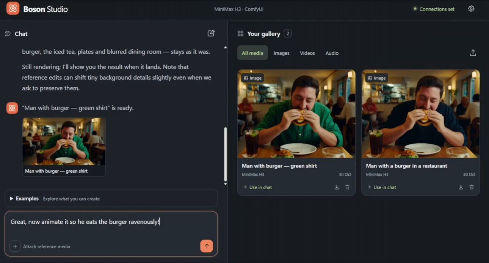

# Boson Studio

**Create images and videos through conversation.** Boson Studio brings a simple chat interface and media gallery to MiniMax H3 running in ComfyUI. Describe an idea, attach a reference, or ask for a change. Your connected AI assistant turns the request into a generation, while Boson Studio prepares the workflow and model-specific prompt behind the scenes.

Use it on desktop or from your phone.

[](docs/BosunStudio-Demo.mp4)

*Click the preview to watch the quick demo.*

## What you can do

| Capability | Try asking |
| --- | --- |
| Create images | “Create an editorial photograph of a blue ceramic cup in morning light.” |
| Create videos with sound | “Make a five-second video of a paper boat on a stream, with gentle water sounds.” |
| Animate an image | “Animate this photo with subtle movement and a slow camera push.” |
| Connect two frames | “Use these images as the first and last frames of a five-second video.” |
| Edit or combine images | “Change the background to a sunlit garden and preserve the person.” |
| Create with references | “Use this character image, this movement reference and this audio to guide a video.” |
| Add audio to a video | “Add restaurant ambience and soft jazz to this clip.” |
| Extend a video | “Continue this video for another five seconds.” |
| Understand an image | “Describe the people, clothing and setting in this picture.” |

The **Examples** menu above the chat box includes ready-to-edit requests and explains which files to attach. Generated results and uploaded references appear in your gallery, where you can preview, download, reuse or remove them. When viewing a result, switch between the **Simple** creative brief and the **Final** prompt submitted for generation.

## Installation

### What you need

- **Node.js 22 or newer**, including npm, on the computer running Boson Studio.
- **FFmpeg and ffprobe** on that computer's PATH for video references, video frame inspection, Add Audio and Extend Video.
- Access to **ComfyUI with native MiniMax H3 support** and the required H3 model files. ComfyUI can run locally or on another machine with suitable GPU hardware.
- Access to a **local or cloud language model** with an OpenAI-compatible chat API, image input and tool/function calling.

Boson Studio does not include ComfyUI, model weights, FFmpeg or a language model. Its workflows use native ComfyUI nodes; no additional custom-node packs are required. NAG is not included.

### Install and launch

1. Clone this repository, or download its ZIP and extract it.
2. Open a terminal in the folder containing `package.json`.
3. Run:

   ```sh
   npm start
   ```

4. Open [http://localhost:3210](http://localhost:3210).

On Windows, you can double-click **start.bat** instead. On macOS or Linux, you can also run `sh start.sh`.

There is no dependency installation or build step: the application uses Node.js built-in libraries. Keep the terminal running while you use the app. Stop it with **Ctrl+C**.

## App setup

Once the app is running, open **Settings** using the icon in the top-right corner.

### 1. Connect ComfyUI

1. Enter the **Instance URL**, for example `http://127.0.0.1:8188`.
2. If your ComfyUI service is behind a proxy requiring authentication, enter its **Bearer token**. Otherwise leave it blank.
3. Click **Connect & discover models**. The check reports the ComfyUI version, required node availability and local FFmpeg/ffprobe availability.
4. Under **Model files**, select your H3 video / first-and-last-frame model, reference model, text encoder, video VAE and audio VAE. Suggested selections are based on filenames; check that they match your installed files.

The supplied workflows target **full, non-distilled H3 weights**. Distilled models may need a different sampling recipe. ComfyUI 0.43.0 has been tested; other installations must expose the required native H3 nodes and compatible model loaders.

### 2. Connect your AI assistant

1. Enter the language model's **API base URL**. For example, a local Ollama service commonly uses `http://127.0.0.1:11434/v1`. For a cloud service, use the provider's OpenAI-compatible API base URL.
2. Enter the exact **Model** identifier supported by that service.
3. Enter an **API key** if the service requires one.
4. Click **Check connection**, then **Save connections**.

Use an API address, rather than a chat website address. The model must support **both images and tool calling** for the full experience. The connection check confirms access to the service's model list; it does not prove those capabilities.

### 3. Create something

Open **Examples**, select a request and adjust it. Attach any required files using **+**, then send your message. You can also drag files into the app or paste an image.

To work on an existing result, use **Use in chat** in its preview and describe the change. Ask for progress in the conversation, or watch the active generation count in the gallery heading.

## Using a phone

The interface supports both desktop and mobile. To open the same studio on a phone, run it on a computer on your trusted local network and follow the [local-network setup instructions](docs/ADVANCED.md#use-from-a-phone-on-your-network).

Connection addresses are interpreted by the computer running Boson Studio. For example, `127.0.0.1` refers to that computer, even when you open the interface on a phone.

## Things to know

- **Add Audio** replaces a video's soundtrack and preserves its original encoded video. Source clips can be 1–15 seconds long.
- **Extend Video** keeps the original clip and appends approximately 3–15 seconds. Source clips can be 1–60 seconds long. The output is re-encoded at 24fps, so it is not a lossless copy.
- Video generation duration follows H3's frame grid and can differ slightly from the requested number of seconds.
- Reference videos must be 2–15 seconds long. Their visuals guide generation; attach separate audio to guide sound. Reference audio is guidance, not an exact audio copy.
- Image editing is generative: details can change beyond the requested edit. A painted-mask canvas and pixel-locked editing are not available.
- The assistant can see image pixels and an ending-frame sample from a video. It does not watch an entire clip or listen to uploaded audio.
- Uploads are limited to 128 MB per file. Images sent to the assistant have a separate 12 MB limit, with up to four visual references included at once.
- This is a local, single-workspace app. It has no accounts or public-hosting authentication.

## Your data

Settings, saved API credentials, conversation, job history and uploaded/generated media are stored in **data/**, created when the app first runs. Keep this folder private and leave it out of Git or any release ZIP. Credentials are stored in plaintext on the backend computer.

Your selected LLM receives conversation text and visual references needed for chat. ComfyUI receives generation prompts and media references. Choose services appropriate for the material you use.

**New chat** clears the conversation while keeping the gallery and jobs. Removing gallery entries is recoverable with **Undo**; local files are retained, and upstream ComfyUI outputs are not deleted.

## Troubleshooting

- **Missing nodes:** use the ComfyUI connection check to see which workflows are affected, then update ComfyUI as needed.
- **Missing model files:** review all five selections under Model files and confirm the files are installed in ComfyUI.
- **Chat works, but images cannot be described or generations do not start:** confirm the chosen LLM supports image input and tool calling.
- **Video processing cannot start:** check that both `ffmpeg -version` and `ffprobe -version` work in the terminal used to launch the app.
- **Cannot connect:** check that the services are running and reachable from the Boson Studio computer. Recheck the URL and any authentication details.

See [advanced configuration and developer notes](docs/ADVANCED.md) for custom ports, executable paths, network access, tests and repository contents.

## Licence

Boson Studio application code is available under the [MIT licence](LICENSE). ComfyUI, model weights and other third-party software retain their own licences. Model files are not bundled. Boson Studio is independently developed and is not affiliated with Higgsfield.
